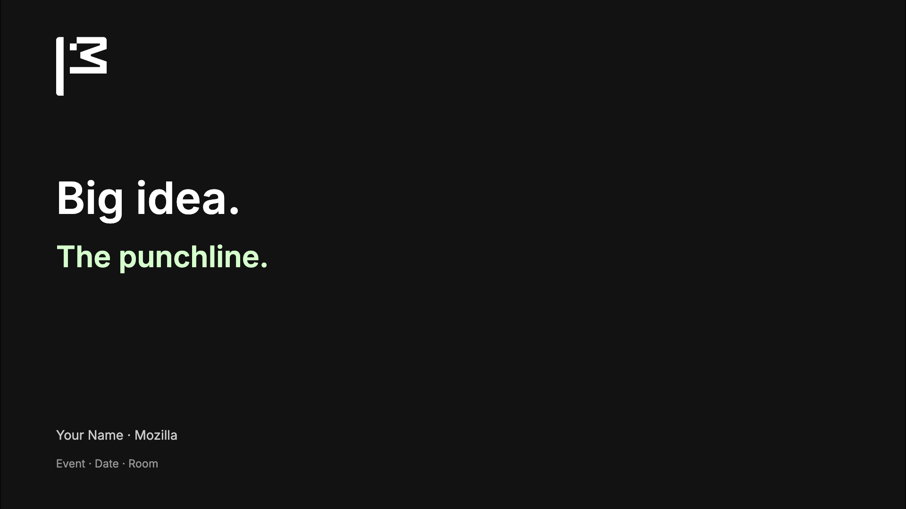
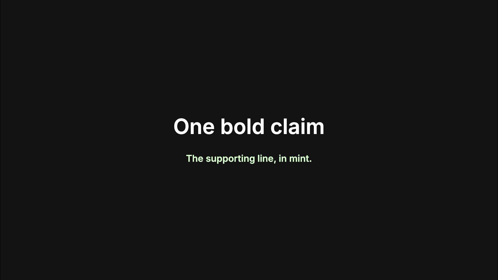
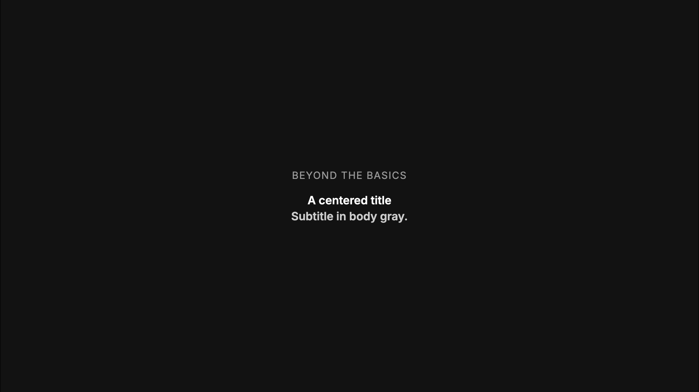
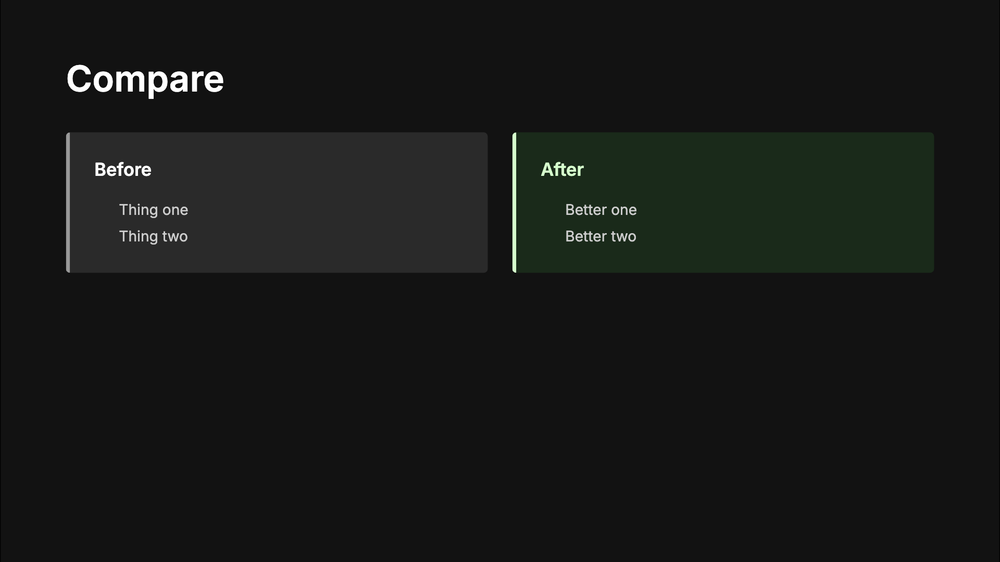
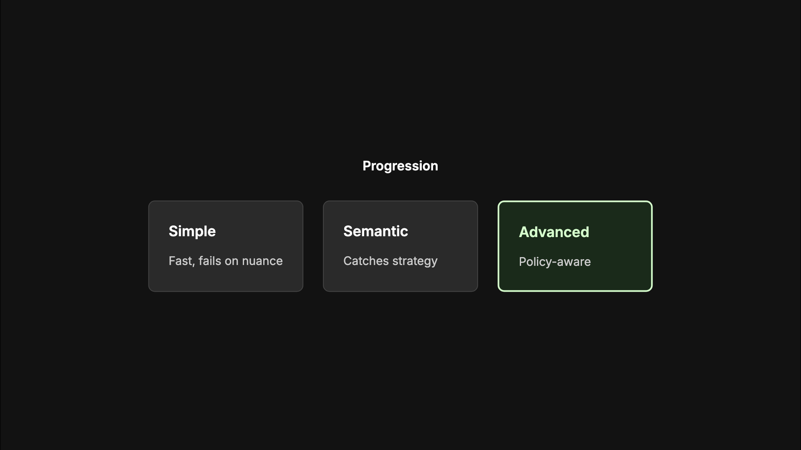
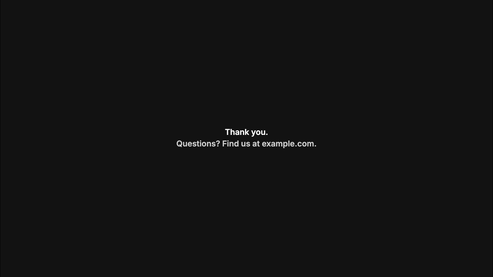

# slidev-theme-mozilla

Dark Mozilla-style theme for [Slidev](https://sli.dev), extracted from the MozFest 2026 talk "Attack the AI. Then Defend It."

## Use

```md
---
theme: ./slidev-theme-mozilla   # or the package name once published
---
```

## Layouts

Pick a layout per slide with `layout:` in that slide's frontmatter. The name is the layout file's name without `.vue`.

| Layout | Frontmatter | Use |
| --- | --- | --- |
| `default` | `layout: default` | Title + content. Also used when a slide has no `layout:` line. |
| `center` | `layout: center` | Centered title and subtitle |
| `statement` | `layout: statement` | One big claim, mint subtitle |
| `cover` | `layout: cover` | Title (`h1`) + subtitle (`h2`, mint); speaker/event info goes in `<template v-slot:meta>`. The Mozilla flag sits top-left (`assets/mozilla-symbol-white.svg`). |
| `end` | `layout: end` | Closing slide |

```md
---
layout: statement
---

# One bold claim
```

## Components

- `<MozEyebrow>` small uppercase kicker above a title
- `<MozCard title variant="plain|accent" edge="box|left">` gray or mint card
- `<MozCards :cols="3">` grid wrapper for cards
- `<MozQR src label url :size>` QR code with caption

## Tokens

CSS variables in `styles/tokens.css` (`--moz-accent`, `--moz-surface`, `--moz-font-sans`, ...). Override them in your own `style.css` to retheme.

The deck's default font is Inter with Fira Code for code; Slidev loads both from the `fonts` defaults.

## Example

`example.md` walks through the layouts and card components. Run it with `npx @slidev/cli example.md`.

| | |
| --- | --- |
| <br>`layout: cover` | <br>`layout: statement` |
| <br>`layout: center` | <br>`layout: default` |
| <br>`layout: center` | <br>`layout: end` |
